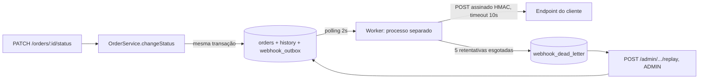

# RFC: Sistema de Webhooks de Notificação de Pedidos

| Campo | Valor |
|---|---|
| **Autora** | Larissa (Tech Lead) |
| **Status** | Em revisão (submetida à equipe) |
| **Data** | 2026-10-26 |
| **Revisores** | Bruno (Eng. Pleno, Pedidos), Diego (Eng. Sênior, Plataforma), Sofia (Eng. de Segurança), Marcos (Product Manager) |
| **Origem** | Reunião técnica de ~55 min (`TRANSCRICAO.md`); Larissa ficou de abrir o doc de design e agendar a revisão com Bruno e Diego antes de codar ([09:50] Larissa) |
| **Documentos do pacote** | [PRD](PRD.md) · [FDD](FDD.md) · [Tracker](TRACKER.md) · ADRs abaixo |

## 1. Resumo executivo (TL;DR)

Vamos notificar os clientes B2B por **webhooks de saída** sempre que o status de um pedido mudar. Em vez de chamar o cliente de dentro de `OrderService.changeStatus`, gravamos o evento em uma tabela **outbox no MySQL, na mesma transação** da mudança de status. Um **worker em processo separado** lê a outbox por polling de 2 s e envia o POST assinado com **HMAC-SHA256** (secret por endpoint). Falhas passam por **5 retentativas com backoff** (1 min a 12 h) e depois vão para uma **DLQ** reprocessável por um admin. A garantia é **at-least-once**, com `X-Event-Id` para o cliente deduplicar. Tudo reutiliza os padrões atuais (módulo `src/modules/webhooks`, `AppError`, Pino). Meta de latência: abaixo de 10 s. Prazo estimado na reunião: três sprints, incluindo a revisão de segurança.

## 2. Contexto e problema

Atlas Comercial, MaxDistribuição e Nova Cargo pediram formalmente para saber, em tempo real, quando o status dos pedidos muda. Hoje consultam `GET /orders` periodicamente, o que deixa a integração lenta e cara para eles; a Atlas sinalizou que pode migrar para um concorrente se a entrega não sair no prazo ([09:00] Marcos). Para os clientes, "tempo real" é qualquer valor abaixo de 10 segundos ([09:02] Marcos). O fluxo é só de saída: eles recebem, não enviam ([09:02] Marcos).

A aplicação (Node.js + TypeScript, Express, Prisma/MySQL) não tem filas, eventos nem notificação externa. O ponto de entrada da mudança é `OrderService.changeStatus`, que já atualiza `orders`, insere em `order_status_history` e movimenta estoque dentro de uma transação (`src/modules/orders/order.service.ts`).

## 3. Proposta técnica

Visão geral (detalhes de implementação no [FDD](FDD.md)):

Pilares da proposta, cada um com sua decisão registrada:

1. **Outbox no MySQL**, atômica com a mudança de status: se commitou, o evento existe; se deu rollback, o evento some ([ADR-001](adrs/ADR-001-outbox-no-mysql.md)).
2. **Worker separado em polling de 2 s**, novo entry point `src/worker.ts` com `npm run worker` e `PrismaClient` próprio ([ADR-005](adrs/ADR-005-worker-separado-em-polling.md)).
3. **Retry com backoff 1m/5m/30m/2h/12h e DLQ** em tabela separada, com replay manual restrito a ADMIN ([ADR-002](adrs/ADR-002-retry-com-backoff-e-dlq.md)).
4. **Segurança**: HMAC-SHA256 sobre o corpo, secret única por endpoint, rotação com 24 h de convivência, HTTPS obrigatório ([ADR-003](adrs/ADR-003-hmac-sha256-com-secret-por-endpoint.md)).
5. **Semântica at-least-once** com `X-Event-Id` para deduplicação pelo cliente ([ADR-004](adrs/ADR-004-entrega-at-least-once-com-x-event-id.md)).
6. **Payload em snapshot** gravado na inserção e **filtro por status aplicado na inserção** ([ADR-007](adrs/ADR-007-snapshot-do-payload-e-filtro-na-insercao.md)).
7. **Reuso de padrões**: módulo igual aos demais, erros `WEBHOOK_*` sobre `AppError`, Pino, middleware de erro atual ([ADR-006](adrs/ADR-006-reuso-dos-padroes-do-projeto.md)).

Superfície de API (contratos completos no FDD): CRUD de webhooks do customer, rotação de secret, histórico de entregas (últimos 100) e replay de DLQ em `POST /admin/webhooks/dead-letter/:id/replay`.

## 4. Alternativas consideradas

| ID | Alternativa | Origem | Trade-off que levou ao descarte |
|---|---|---|---|
| RFC-ALT-01 | HTTP **síncrono** dentro de `changeStatus` | [09:04] Bruno, [09:06] Diego | Cliente lento trava a transação; cliente fora do ar obrigaria rollback ou perda do evento. |
| RFC-ALT-02 | **Redis Streams** ou fila equivalente | [09:07] Larissa, Diego | Infra nova para um time pequeno; "overengineering". |
| RFC-ALT-03 | **Trigger/notificação do banco** para acordar o worker | [09:09] Bruno, Diego | MySQL não tem listener nativo; trigger só executa SQL. Polling de 2 s já atende os 10 s. |
| RFC-ALT-04 | **Retry indefinido** com backoff | [09:15] Diego | Evento fica pendurado para sempre se o cliente sumiu. |
| RFC-ALT-05 | **3 tentativas** (mais agressivo) | [09:16] Bruno, Diego | Janela de ~30 min não cobre manutenção de 2 h já vista em cliente. |
| RFC-ALT-06 | **Secret global** da plataforma | [09:21] Sofia | "Se vaza uma, vaza tudo". |
| RFC-ALT-07 | **Exactly-once** | [09:25] Diego | Exige coordenação dos dois lados; complexidade muito maior. At-least-once com `event_id` resolve "99% dos casos". |
| RFC-ALT-08 | Marcar `FAILED` na própria outbox em vez de tabela de DLQ | [09:17] Larissa, [09:18] Diego | Polui a leitura da outbox principal e perde a evidência separada para debug e replay. |

## 5. Questões em aberto

**Levantadas e adiadas na reunião**

| ID | Questão | Origem | Situação |
|---|---|---|---|
| RFC-OPEN-01 | **Rate limiting de saída** (ex.: 50 pedidos mudando em 1 min geram 50 chamadas ao cliente?) | [09:38] Diego, [09:39] Larissa | "Observar e decidir depois"; fora do escopo. Precisa de métrica para decidir. |
| RFC-OPEN-02 | **Aviso ao cliente por e-mail** quando o webhook falha repetidamente | [09:37] Marcos, [09:37] Larissa | Próxima fase, depois de medir o impacto. |
| RFC-OPEN-03 | **Ordering com vários workers** (particionar por `order_id` ou lock pessimista) | [09:13] Diego | "Problema do futuro"; hoje, limitação conhecida (só por `order_id` e só com worker único). |
| RFC-OPEN-04 | **Arquivamento da outbox** (entregues com ~30 dias) | [09:08] Diego | Fora do escopo desta feature; sem rotina, a tabela cresce. |
| RFC-OPEN-05 | **Endurecer permissões** do CRUD de webhooks (hoje qualquer role autenticada) | [09:37] Sofia | "Mais pra frente a gente pode endurecer." |

**Identificadas na elaboração deste pacote (não decididas na reunião; para Diego, Larissa e Sofia)**

| ID | Questão | Evidência |
|---|---|---|
| RFC-OPEN-06 | **Contagem das tentativas**: "5 tentativas" com 5 intervalos e janela de "quase 15 h" só fecha como 1 envio inicial + 5 retentativas (6 requisições). Reforço: com 3 tentativas Diego "retentaria três vezes em 30 minutos" (1m+5m+30m), ou seja, os intervalos contam retentativas. Falta confirmar. | [09:17] Larissa, [09:17] Diego, [09:16] Diego |
| RFC-OPEN-07 | **Ordering sob retry e replay**: um evento esperando retry, ou reenviado pela DLQ, pode ser ultrapassado por um posterior do mesmo pedido. Aceitar como limitação ou bloquear os eventos seguintes do mesmo `order_id` enquanto houver evento pendente. | [09:12] Diego, [09:17] Diego |
| RFC-OPEN-08 | **`X-Timestamp` fora da assinatura**: a assinatura cobre só o corpo, logo o cliente não detecta replay de forma autenticada. Incluir o timestamp no material assinado? | [09:22] Sofia, [09:44] Diego |
| RFC-OPEN-09 | **Destinos permitidos da URL** (rede interna, localhost, redirects): só HTTPS foi exigido. Tratar na revisão de segurança. | [09:23] Sofia |
| RFC-OPEN-10 | **Autorização por customer**: o JWT e o model `User` não ligam o usuário a um customer; qualquer usuário autenticado gerenciaria webhooks de qualquer customer. Sofia aceitou "qualquer role" por ora, não o acesso entre customers. | [09:32] Marcos, [09:36] Marcos, [09:37] Sofia |

## 6. Impacto e riscos

**Impacto em código existente**: a alteração crítica é no `changeStatus` ([09:40] Bruno); o resto são ajustes de registro, configuração e logging listados no FDD (§10). Todo o restante é código novo isolado (módulo `webhooks`, worker, tabelas e migration), conforme o reuso máximo de padrões de [09:30] Larissa.

**Prazo**: três sprints incluindo revisão de Sofia (outbox/DLQ: 1; worker/retry: 1; CRUD/deliveries: 0,5; integração e testes e2e: 0,5; HMAC, schemas e validações: o restante), com pelo menos dois dias úteis reservados para Sofia antes do deploy ([09:46] Larissa, [09:46] Sofia). A Atlas quer a entrega até o fim de novembro ([09:45] Marcos).

| Risco | Prob. | Impacto | Mitigação |
|---|---|---|---|
| Outbox falhar derruba a mudança de status | Baixa | Alto | Comportamento intencional ([09:40] Bruno); testes e2e da transação. |
| Cliente não deduplica por `event_id` | Média | Médio | Documentar no portal ([09:26] Marcos). |
| Vazamento de secret pelo cliente | Média | Alto | Secret por endpoint e rotação com 24 h de convivência ([09:22] Sofia). |
| Cliente lento atrasa a fila (worker único, timeout de 10 s) | Média | Médio | Métrica de idade do evento mais antigo pendente; evolução em RFC-OPEN-03. |
| Qualquer usuário autenticado gerencia webhooks de qualquer customer (RFC-OPEN-10) | Média | Alto | Decidir vínculo usuário→customer ou restringir a ADMIN na revisão de Sofia. |
| Prazo da Atlas e janela da revisão de segurança | Média | Alto | Agendar Sofia cedo ([09:49] Sofia). |

## 7. Decisões relacionadas

- [ADR-001: Outbox no MySQL](adrs/ADR-001-outbox-no-mysql.md)
- [ADR-002: Retry com backoff e DLQ](adrs/ADR-002-retry-com-backoff-e-dlq.md)
- [ADR-003: HMAC-SHA256 com secret por endpoint](adrs/ADR-003-hmac-sha256-com-secret-por-endpoint.md)
- [ADR-004: Entrega at-least-once com `X-Event-Id`](adrs/ADR-004-entrega-at-least-once-com-x-event-id.md)
- [ADR-005: Worker separado em polling](adrs/ADR-005-worker-separado-em-polling.md)
- [ADR-006: Reuso dos padrões do projeto](adrs/ADR-006-reuso-dos-padroes-do-projeto.md)
- [ADR-007: Snapshot do payload e filtro na inserção](adrs/ADR-007-snapshot-do-payload-e-filtro-na-insercao.md)
